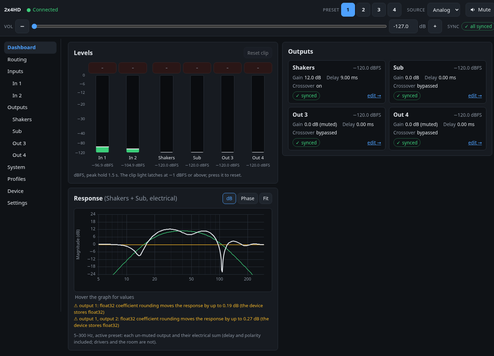

# minidsp-webui

minidsp-webui is a self-hosted web UI for miniDSP devices (built around the **2x4 HD**) that runs on top of
[minidsp-rs](https://github.com/mrene/minidsp-rs)'s `minidspd` daemon on Linux, for example on a Raspberry Pi.
It gives you live meters, every per-channel DSP setting and draggable PEQ/crossover response graphs in the browser, plus
Home Assistant entities over MQTT discovery, so you don't need the Windows plugin app.

<p align="center"></p>

## Features

### Master controls and meters
- **Persistent header** on every page: master volume (slider, ±0.5 dB steps, numeric entry), mute, input source and
  preset 1–4.
- **Live level meters** for every input and output, with 1.5 s peak hold and a latching clip light at −1 dBFS.
- **Changes made elsewhere show up** within a couple of seconds: IR remote, front panel, the `minidsp` CLI, Home Assistant.

### Routing and channels
- **Routing matrix:** enable each input → output path, with a gain per path.
- **Per channel:** gain, mute and polarity. Output delay comes with a distance helper (metres/feet → ms at 343 m/s) and
  shows the delay in samples.
- **Channel names and colours** ("Shakers", "Sub") are used everywhere, including Home Assistant.

### Filters and graphs
- **10-band PEQ per input and output:** peaking, shelves, low/high-pass, band-pass, notch, all-pass, Linkwitz Transform
  or raw biquads. Edit them in a table or by dragging handles on the response graph (drag for frequency and gain, scroll
  for Q).
- **Crossovers:** two groups of four biquads per output, designed as Butterworth, Linkwitz-Riley or Bessel up to
  48 dB/oct. A "biquads used" indicator and a raw coefficient table are included.
- **Response graphs:** magnitude, phase and group delay for each filter, each channel's full chain, and a **system view**
  that sums several outputs electrically (delay and polarity included) to show where they add or cancel.
- Responses are computed with the device's float32 coefficients, with a warning when rounding moves the curve.

### Compressor and FIR
- **Compressor per output:** threshold, ratio, attack and release, with a transfer-curve graph and presets such as
  "Tactile limiter".
- **FIR loading from a 96 kHz WAV**, with impulse and response preview. It's experimental on the 2x4 HD and hidden
  until you enable it.

### Import and export
- **`minidsp` CLI scripts** (`minidsp -f` format), **REW** biquad files for PEQ banks and crossovers, and a full
  **JSON backup** of the whole setup.
- **Nightly SQLite backups**, keeping the newest 14, restorable from Settings.

### Profiles and history
- **Named profiles:** save the current preset, load a profile into any preset slot, and diff any two configurations.
- **Revision history per preset** with one-click revert.

### Sync, adopt and verify
- **The app keeps the configuration**, because the miniDSP can't report most DSP settings back. Every setting shows
  whether it is synced, pending, failed or unknown.
- **Staged edits:** changes to an inactive preset are written when that preset becomes active.
- **Adopt an existing setup:** trust what's on the device, push a known config, or import a CLI script. Known filter
  coefficients are recognised and shown as "LR4 LP 80 Hz" rather than raw numbers.
- **Verify device:** reads the readable settings back from DSP memory and flags anything that changed behind the app's
  back.
- **Event log** of user actions, apply results, reconnects and every master change, with who made it
  (`ui`, `ha`, `api`, `external`).

### Home Assistant (MQTT discovery)
- Master volume, mute, source and preset; per-output gain, mute and delay; a profile select; a push-all button; and
  connectivity, sync and (optional) level sensors.
- Entities appear automatically under one "miniDSP" device. The app publishes availability, so they go unavailable when
  the app stops.

### Safety and footprint
- **Gain limits:** global gain limits plus a ceiling per channel. Raising a level by more than a set step asks for
  confirmation.
- **Big master-volume drops** in the UI ask for confirmation too.
- **Filter writes are guarded:** unstable biquads are refused, a PEQ band is never un-bypassed before its coefficients
  are on the device, and bulk applies mute the affected outputs while they run.
- **SD-card friendly:** debounced SQLite writes, no disk writes while idle, and logs to stdout only. It runs in about
  80–90 MB of RAM on a Raspberry Pi 3.
- **Works offline and on phones:** every JavaScript/CSS library is vendored, and there is no JavaScript build step.
- **Several devices:** everything is keyed by device serial, and a switcher appears when more than one device is found.

Works with minidspd 0.1.12, the current minidsp-rs release.

## Setup

`minidspd` binds to loopback by default, so run the container on the machine that runs the daemon, with host
networking. [`docker-compose.example.yml`](docker-compose.example.yml) is a complete example:

```yaml
services:
  minidsp-webui:
    image: ghcr.io/ljmerza/minidsp-webui:main
    network_mode: host
    environment:
      MINIDSPD_URL: http://127.0.0.1:5380
      WEBUI_PORT: "8480"
    volumes:
      - ./data:/data
    restart: unless-stopped
    mem_limit: 256m
```

Then open `http://<host>:8480`. Images are published for `linux/amd64` and `linux/arm64`.

The app has no login. Anyone who can reach the port can change the device, so keep it on a trusted network or put
it behind a reverse proxy that adds authentication. When proxying, turn buffering off for `/api/v1/events` (nginx:
`proxy_buffering off;`), or live updates stall.

The container runs as uid 1000 and needs no USB access or privileges (the daemon owns the device). With **rootless
Docker**, uid 1000 in the container maps to a different uid on the host, so a data directory owned by your user isn't
writable. The app then falls back to in-memory state: `/api/v1/health` reports `"state": "memory"` and the UI shows a
banner. Fix the ownership once:

```bash
docker run --rm --user 0 --entrypoint chown -v "$PWD/data:/data" ghcr.io/ljmerza/minidsp-webui:main 1000:1000 /data
```

### Health

- `GET /healthz` is the liveness probe the image's `HEALTHCHECK` uses. It answers as long as the app is running.
- `GET /api/v1/health` reports `status` (`ok`, `degraded` or `starting`) and a readable `problems` list: minidspd
  unreachable, device missing, live stream reconnecting, settings that failed to write, or state that isn't being
  saved. The app keeps retrying on its own in all of these cases, and the UI shows a banner meanwhile.

### Upgrading

Back up first (Settings → Backup), then run `docker compose pull && docker compose up -d`. Database migrations run
automatically at startup.

### Configuration

Every setting is an environment variable. Values marked † can also be changed on the Settings page; values saved
there take precedence over the environment.

#### Server

| Variable | Default | Description |
|---|---|---|
| `MINIDSPD_URL` | `http://127.0.0.1:5380` | minidspd HTTP API |
| `WEBUI_BIND` | `0.0.0.0` | Listen address |
| `WEBUI_PORT` | `8480` | Listen port |
| `DB_PATH` | `/data/minidsp-webui.sqlite3` | SQLite database; nightly backups go to `backups/` next to it |
| `LOG_LEVEL` | `info` | Log level |
| `PUBLIC_URL` | _(empty)_ | The UI's external URL, used for Home Assistant's "visit device" link |
| `DAEMON_TIMEOUT_S` | `5` | Timeout for minidspd HTTP calls (seconds) |
| `DISCOVERY_INTERVAL_S` | `30` | How often to rescan minidspd for devices (it retries faster while something is missing) |
| `MONITOR_BACKOFF_MIN_S` / `MONITOR_BACKOFF_MAX_S` | `0.5` / `10` | Reconnect backoff for a device's live status stream |
| `LEVELS_IDLE_GRACE_S` | `5` | How long the level meters stay on after the last viewer leaves (level polling uses USB bandwidth) |

#### Sync

| Variable | Default | Description |
|---|---|---|
| `WRITE_COALESCE_MS` † | `50` | Gather window for edits before they are written to the device |
| `MUTE_WRAP_BULK_APPLY` † | `true` | Mute the affected outputs while a bulk apply (push, import, profile load) runs |
| `REAPPLY_ON_RECONNECT` † | `false` | Push the active preset again after the device reconnects (e.g. after a power cycle) |
| `PRESET_SWITCH_TIMEOUT_S` | `15` | How long to wait for the device to report a new preset |

#### Safety

| Variable | Default | Description |
|---|---|---|
| `GAIN_MIN_DB` / `GAIN_MAX_DB` | `-72` / `12` | Allowed range for channel and routing gains (must stay within -100 to +24) |
| `GAIN_STEP_CONFIRM_DB` † | `6` | Raising a level by more than this in one step asks for confirmation (master volume, channel gains, a PEQ band's or crossover group's peak boost) |
| `VOLUME_DROP_CONFIRM_DB` † | `20` | In the UI, lowering the master volume by more than this in one action asks for confirmation. Home Assistant and the API are never blocked; their changes are logged |
| `PEQ_MAX_BOOST_DB` | `24` | Most a single PEQ band or crossover group may boost; larger boosts are refused |
| `FIR_EXPERIMENTAL` † | `false` | Show the FIR tab on models whose FIR support is unverified (the 2x4 HD). Loading taps mutes the device briefly |

#### MQTT / Home Assistant

| Variable | Default | Description |
|---|---|---|
| `MQTT_ENABLED` | `false` | Publish Home Assistant entities over MQTT discovery |
| `MQTT_HOST` / `MQTT_PORT` | _(empty)_ / `1883` | MQTT broker, e.g. `mqtt.example.lan` |
| `MQTT_USERNAME` / `MQTT_PASSWORD` | _(empty)_ | Broker credentials (use an env file, not the compose file) |
| `MQTT_DISCOVERY_PREFIX` | `homeassistant` | Home Assistant discovery prefix |
| `MQTT_BASE_TOPIC` | `minidsp-webui` | Prefix for state, command and availability topics |
| `MQTT_VOLUME_FLOOR_DB` | `-127` | Lowest master volume the Home Assistant slider offers |
| `MQTT_LEVELS` | `false` | Feed the input/output level sensors (at most 1 Hz; keeps the device's level polling on) |

## Development

```bash
uv sync --group dev
make lint                # ruff check + format check
make test                # unit tests, no docker needed
make dev-up              # mock minidspd on 127.0.0.1:15380 + the UI with hot reload on 127.0.0.1:8480
make test-integration    # integration tests against the dev stack (starts and stops it as needed)
make dev-down
```

The dev stack (`docker-compose.dev.yml`) runs the real `minidspd` 0.1.12 against its built-in mock device, so no
hardware is needed. `tests/integration/MOCK_NOTES.md` lists what the mock does and doesn't simulate. To run the app
outside Docker against it: `MINIDSPD_URL=http://127.0.0.1:15380 DB_PATH=.devdata/local.sqlite3 uv run python -m
app.main`.

The JSON API is under `/api/v1` (OpenAPI docs at `/docs`), and live updates are a Server-Sent Events stream at
`/api/v1/events`. The MQTT integration tests start a throwaway Mosquitto container on a random port; they never touch
a real broker.

### How it works

- A FastAPI backend talks to `minidspd`'s HTTP API (default `http://127.0.0.1:5380`) and keeps one live status
  stream open per device.
- Desired state, the last confirmed device state, history, profiles and the event log live in SQLite. Database
  writes are debounced and the event log is trimmed daily, to spare SD cards.
- One writer per device coalesces edits (a slider drag becomes a few writes, not hundreds), checks the active preset
  before every write, and retries failed writes with backoff, giving up on a setting after 5 attempts.
- The UI is server-rendered (Jinja, HTMX, Alpine.js, uPlot) with Server-Sent Events for live updates, so every open
  tab converges on the same state.

CI runs ruff and pytest on every pull request and builds multi-arch images to GHCR, using the reusable workflows in
[ljmerza/misc-actions](https://github.com/ljmerza/misc-actions).
